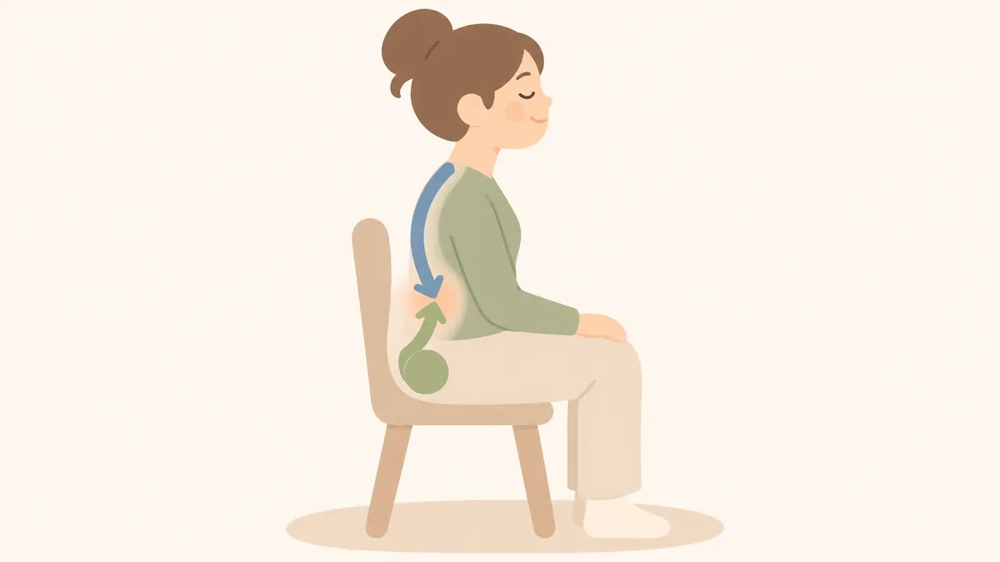

# ずっと座っていると腰が痛いのはなぜ？揉んでもらっても、また痛くなる理由

ずっと座っていると腰が痛くなるのは、腰が悪いというより、股関節と背骨が動いていないからです。だから揉んでもらっても、また痛くなります。伸びをする前に腰を丸めること、股関節を動かすことから始めてください。

&nbsp;

&nbsp;

&nbsp;

&nbsp;

&nbsp;

この記事の執筆・監修：奥村龍晃（柔道整復師） 
ーーーーーーーーーーーーーーーーーーーーーーーーーーーーーー

こんにちは！

脊柱側弯症専門のフィジカルバランスラボ整体院、 
院長の奥村龍晃です。

&nbsp;

<nav class="toc"><strong>目次</strong>
<ol>
  <li><a href="#痛くなる理由">なぜ座っているだけで腰が痛くなるのですか？</a></li>
  <li><a href="#揉んでもまた痛くなる">腰を揉んでもらっても、また痛くなるのはなぜですか？</a></li>
  <li><a href="#伸びをしてもいいか">長く座ったあと、ぐーっと伸びをしてもいいですか？</a></li>
  <li><a href="#自分でできること">自分でできることはありますか？</a></li>
  <li><a href="#それでも痛いとき">それでも腰が痛いときは、どうすればいいですか？</a></li>
</ol>
</nav>

ずっと座っていると腰が痛くなるのは、腰が悪いというより、股関節と背骨が動いていないからです。だから腰を揉んでもらうと、その時は楽になっても、また痛くなるんです。

この記事では、腰が痛いのに僕が腰以外を見る理由と、デスクワークなどでずっと座っている方に最初にやってほしいことをお話しします。

先にひとつだけ。次のような場合は、この記事に書いてあることを試す前に、整形外科などの医療機関を受診してください。

- 安静にしていても痛みが軽くならない、または次第に悪くなっている
- 新たに脚のしびれや力の入りにくさが出てきた、または強くなっている
- 熱がある、または転倒などの強い衝撃のあとから痛む

**腰痛とあわせて、尿が出にくい・漏れる、便を漏らす、股の間やお尻の感覚が鈍い、急に脚に力が入らない、といった症状があるときは、すぐに救急の医療機関へご相談ください。**

<h2 id="痛くなる理由">なぜ座っているだけで腰が痛くなるのですか？</h2>

どこが動かないと腰が痛くなるかというと、1つは股関節なんです。

座っている間、股関節はずっと曲がりっぱなしじゃないですか。そのまま動かさないでいると、お尻の方から腰の方へ硬さがどんどん広がって、腰が痛くなります。

もう1つは背骨です。これは座っていても立っていても同じで、背骨そのものが動かないと、今度は背中の方から腰にかけて硬さが広がって、腰が痛くなります。

ずっと座っていると、この両方が一度に来るんです。

歩いていると、その分、股関節は固まりにくくなります。同じ仕事の日でも、外回りで歩いた日より、一日中会議で座っていた日の方が腰がつらい。あれは気のせいではありません。

股関節と背中の両方が固まると、寝返りの回数も減ります。寝返りが少ない人は、やっぱり腰痛が出やすいんです。寝ている間も体が固まったままなので、朝起きたときにも腰が痛くなります。

<h2 id="揉んでもまた痛くなる">腰を揉んでもらっても、また痛くなるのはなぜですか？</h2>

股関節と背骨が固まったままだからです。

揉んでもらうと、硬くなった腰の筋肉がゆるむので、その時は楽になります。でも、股関節と背骨が動かないままなら、腰はまた硬くなります。ずっと座っていて腰が痛い方の場合、腰には痛みが出ているだけで、原因は別のところにある。僕はそう見ています。

腰痛の方を見るときに僕が絶対にチェックするのは、背骨の硬さ、骨盤の位置、骨盤に対して股関節がずれていないかの3つです。

立ち上がるときに腰が痛いのに、少し動くと楽になる。こういう方は、僕はまず股関節を疑います。立ち上がるときは股関節が大きく動くので、その動きを腰が受け止められなくなっているんです。

もうひとつ見るのが、腸腰筋です。腰の骨から股関節をまたいでついている、お腹の奥の筋肉です。ここが硬くなると、腰が反ったまま固まってしまいます。長く腰痛に悩んでいる方や股関節が硬い方は、ここが必ず硬くなっています。

当院では、まず硬くなった筋肉をゆるめて痛みをやわらげます。次に、痛みが再発しにくいように股関節の位置を整えます。そのあとは、歩いて股関節を動かす幅を保ち、お尻のトレーニングで骨盤が前に行かないようにしていきます。施術の進め方は、[腰痛のページ](https://physical-balance-lab.com/guidance/youtsu-1/)にまとめています。

<h2 id="伸びをしてもいいか">長く座ったあと、ぐーっと伸びをしてもいいですか？</h2>

やってもいいんですが、先にやってほしいことがあります。

長く座ったあと、立ち上がって両手を上げて、ぐーっと伸びをしますよね。あれ、腰を伸ばしているつもりで、実は腰を縮めているんです。

ずっと同じ姿勢でいると、腰は反ったまま固まりやすくなります。そこからさらに反ると、腰の筋肉が縮んで圧力がかかるので、かえって痛くなりやすいんです。

なので、順番を変えてください。先に腰を丸めて、腰の筋肉を伸ばす。伸びをしたり、体を横に倒したり、ひねったりするのは、そのあとです。

<h2 id="自分でできること">自分でできることはありますか？</h2>

あります。やってほしいことは3つです。

**1つ目は、腰を丸めること。** 腰の骨を後ろに突き出すイメージで、ぐーっと腰を丸めます。腰が少し突っ張る感じがしたら、腰の筋肉が伸びています。立ったままでも、椅子に座ったままでもかまいません。

いちばん簡単なのは体育座りです。お家でテレビを見ているときや、お風呂の湯船の中で、体育座りをしてみてください。特に湯船はおすすめです。温めながら腰が丸まるので、腰の筋肉が伸びてゆるみます。

1日に1分でも多くやる。それだけでも結構変わりますよ。

ただし、腰を丸めると痛みやしびれが強くなる方は、すぐにやめてください。同じ腰痛でも、体の状態によって合う動きは変わります。ヘルニアやすべり症と言われている方は、自分の判断で始めず、かかっている医療機関か当院にご相談ください。

**2つ目は、股関節を動かすこと。** 肩を動かすのも大事ですが、腰に関しては股関節を動かすのが一番大事です。いちばん手軽なのは歩くことです。力を抜いて、いつもより少しだけ歩幅を大きくして歩いてください。ドスンドスンと大股で歩く必要はありません。

**3つ目は、長い時間同じ姿勢を続けないこと。** 体が沈むようなソファーも、座らない方がいいです。

<h2 id="それでも痛いとき">それでも腰が痛いときは、どうすればいいですか？</h2>

一度、体を見せてください。

股関節なのか、背骨なのか、それともほかの場所なのかは、検査をしないと分かりません。当院に通う通わないは別として、自分の腰痛がどこから来ているのかを知っておくと、自分で何をやればいいかがはっきりします。

腰痛の施術の進め方と料金は、次のページにまとめています。

- [腰痛](https://physical-balance-lab.com/guidance/youtsu-1/)

通う間隔の考え方は、「[整体は何回通えばいい？](https://physical-balance-lab.com/3049/)」の記事に書いています。はじめて来られる方は、[はじめての方へ](https://physical-balance-lab.com/for-newcomers/)もご覧ください。

<strong>※免責事項</strong> 
本記事の内容は一般的な情報提供を目的としており、個別の診断や治療を意図したものではありません。 
痛みや不調がある場合、運動中に痛みが出た場合は中止し、必要に応じて医療機関にご相談ください。 
症状が続く、強くなる、または日常生活に支障がある場合は、期間にかかわらず医療機関にご相談ください。

&nbsp;

公式LINEへのメッセージ送信は24時間可能です。返信は営業時間内です。 
ご予約や当院の一般的なご案内についてお問い合わせいただけます。

&nbsp;

<a class="q_custom_button q_custom_button3" href="https://lin.ee/9tbKaUW" target="_blank" rel="noopener">公式LINE</a>

&nbsp;

<footer>

ーーーーーーーーーーーーーーーーーーーーーーーーーーーー 
〒464-0026 
愛知県名古屋市千種区井上町117 井上協栄ビル2階 
名古屋市営地下鉄東山線「星ヶ丘駅」2番口徒歩2分 
愛知県名古屋市で、姿勢や日常動作についてのご相談を受け付ける整体院 
フィジカルバランスラボ整体院 
ーーーーーーーーーーーーーーーーーーーーーーーーーーーー

</footer>

