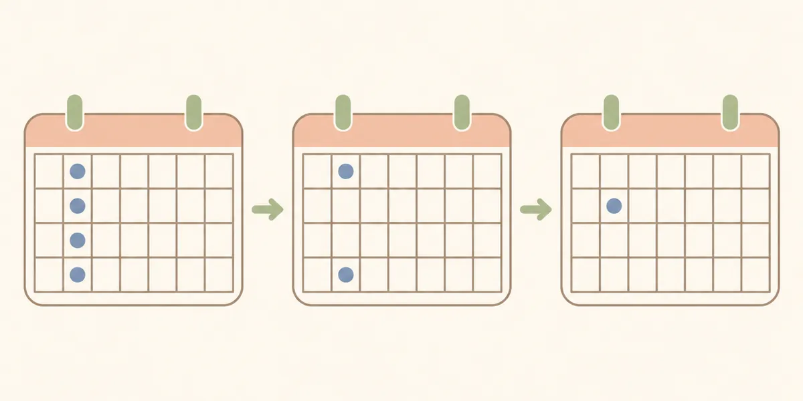

# 整体は何回通えばいい？当院が通院の間隔を決めるときに見ていること

何回通うかは体の状態と生活で違うため、当院では最初から回数を決めていません。痛みが強い時期は間隔を詰め、落ち着いてきたら広げ、最後は通わなくても調子がいい状態を目指します。

&nbsp;

&nbsp;

&nbsp;

&nbsp;

&nbsp;

この記事の執筆・監修：奥村龍晃（柔道整復師） 
ーーーーーーーーーーーーーーーーーーーーーーーーーーーーーー

こんにちは！

脊柱側弯症専門のフィジカルバランスラボ整体院、 
院長の奥村龍晃です。

&nbsp;

<nav class="toc"><strong>目次</strong>
<ol>
  <li><a href="#間隔の例">どのくらいの間隔で通いますか？</a></li>
  <li><a href="#最初に間隔を詰める理由">なぜ最初は間隔を詰めるのですか？</a></li>
  <li><a href="#間隔を広げるときに見ること">間隔を広げるときは、何を見ていますか？</a></li>
  <li><a href="#いつまで通うか">いつまで通えばいいですか？</a></li>
  <li><a href="#初回で決める必要はあるか">初回で、通い続けるかどうかを決める必要はありますか？</a></li>
</ol>
</nav>

何回通えばよいかは、体の状態と生活によって違うため、当院では最初から回数を決めていません。決めているのは進め方です。痛みが強い時期は間隔を詰め、落ち着いてきたら間隔を広げ、最後は当院に通わなくても調子がいい状態を目指します。

この記事では、僕が通院の間隔を決めるときに何を見ているかをお話しします。

<h2 id="間隔の例">どのくらいの間隔で通いますか？</h2>

当院でよくある進み方は、次の通りです。

<table style="width: 100%; table-layout: fixed;">
<thead>
<tr><th style="white-space: normal; padding: 8px;">体の状態</th><th style="white-space: normal; padding: 8px;">間隔の例</th><th style="white-space: normal; padding: 8px;">この時期にすること</th></tr>
</thead>
<tbody>
<tr><td style="white-space: normal; padding: 8px;">痛みが強い</td><td style="white-space: normal; padding: 8px;">週に1回ほど</td><td style="white-space: normal; padding: 8px;">痛みをやわらげることを優先する</td></tr>
<tr><td style="white-space: normal; padding: 8px;">痛みが落ち着いてきた</td><td style="white-space: normal; padding: 8px;">2〜3週間に1回ほど</td><td style="white-space: normal; padding: 8px;">自分でできるケアやトレーニングを進める</td></tr>
<tr><td style="white-space: normal; padding: 8px;">調子のいい状態が続いている</td><td style="white-space: normal; padding: 8px;">1か月〜1か月半に1回ほど</td><td style="white-space: normal; padding: 8px;">体の状態を確認する</td></tr>
</tbody>
</table>

これはあくまで例です。どの段階にどのくらいかかるかは人によって違い、この通りに進むとは限りません。ご自身の目安は、初回の検査のあとにご説明します。料金と通院の目安は、[腰痛](https://physical-balance-lab.com/guidance/youtsu-1/)、[肩こり](https://physical-balance-lab.com/guidance/katakori-1/)、[五十肩](https://physical-balance-lab.com/guidance/gojukata-1/)、[脊柱側弯症](https://physical-balance-lab.com/guidance/sokuwanshou-1/)の各ページにも書いています。

通っている途中で、痛みが急に強くなったときや、しびれが強くなったとき、力が入りにくくなったときは、次の予約を待たずに医療機関へご相談ください。

<h2 id="最初に間隔を詰める理由">なぜ最初は間隔を詰めるのですか？</h2>

痛みが強いままだと、トレーニングを始められないからです。

たとえば腰痛の方には、お尻の筋肉のトレーニングをお願いすることがあります。このトレーニングをいつ始められるかで、当院に通う期間の長さが変わってきます。だから僕は、最初の時期だけ少し頑張って、週に1回ほど来ていただけないかとお願いしています。

もちろん、お仕事やご家庭の都合があるので、無理のない範囲でかまいません。

間隔を詰めるといっても、毎日受ければよいわけではありません。続けて受けたいという方にも、丸二日は空けていただいています。

<h2 id="間隔を広げるときに見ること">間隔を広げるときは、何を見ていますか？</h2>

前回の施術から今日までを、どう過ごせたかを見ています。

来院のたびに僕が聞くのは、痛みの強さ、痛みが出る回数、楽な状態がどのくらい続いたかです。前回から1か月、特に困らず過ごせたなら、次はもう少し空けてみましょうとお話しします。確認の時期に入ってからも、問題がなければ間隔はさらに広げていきます。

間隔を広げるのは、普段の生活の中でその間隔を保てるかを確かめるためでもあります。3週間空けるなら、3週間のあいだ体の調子を保てるかどうかを確認したいのです。大事な予定が近いかどうかも、考えに入れます。

<h2 id="いつまで通うか">いつまで通えばいいですか？</h2>

当院に通わなくても調子がいい状態になるまでです。僕はこれを「卒業」と呼んでいて、最初にお話ししています。ずっと通ってくださいとは言いません。当院は開業当初から「再発しない治療」を目指しています。

施術を受ける時間は、1日24時間のうちの1時間ほどです。頻繁に通っても、週に1回ほどでしょう。体にとっては、残りの23時間をどう過ごしているかの方が大事だと、僕は考えています。

ですから卒業のために大事なのは、普段の自分のくせを知っていることと、そのくせへの対策を自分でできることです。当院では立ち方や歩き方のくせを確認して、その方に合ったセルフケアをお伝えします。いきなり全部を自分でやるのは難しいので、できるようになるまでは僕が手伝います。

困っていることがないのに、定期的に通う必要はないと僕は考えています。

<h2 id="初回で決める必要はあるか">初回で、通い続けるかどうかを決める必要はありますか？</h2>

ありません。通うかどうかは、初回を受けてから考えていただいて大丈夫です。施術には、合う、合わないもあります。

お仕事が忙しい方や、遠くから来られる方は、検査のときにそうお伝えください。通える間隔で何ができるかを、一緒に考えます。

症状ごとの料金と通院の目安は、次のページにまとめています。

- [腰痛](https://physical-balance-lab.com/guidance/youtsu-1/)
- [肩こり](https://physical-balance-lab.com/guidance/katakori-1/)
- [五十肩](https://physical-balance-lab.com/guidance/gojukata-1/)
- [脊柱側弯症](https://physical-balance-lab.com/guidance/sokuwanshou-1/)

はじめて来られる方は、[はじめての方へ](https://physical-balance-lab.com/for-newcomers/)もご覧ください。

<strong>※免責事項</strong> 
本記事の内容は一般的な情報提供を目的としており、個別の診断や治療を意図したものではありません。 
痛みや不調がある場合、運動中に痛みが出た場合は中止し、必要に応じて医療機関にご相談ください。 
症状が続く、強くなる、または日常生活に支障がある場合は、期間にかかわらず医療機関にご相談ください。

&nbsp;

公式LINEへのメッセージ送信は24時間可能です。返信は営業時間内です。 
ご予約や当院の一般的なご案内についてお問い合わせいただけます。

&nbsp;

<a class="q_custom_button q_custom_button3" href="https://lin.ee/9tbKaUW" target="_blank" rel="noopener">公式LINE</a>

&nbsp;

<footer>

ーーーーーーーーーーーーーーーーーーーーーーーーーーーー 
〒464-0026 
愛知県名古屋市千種区井上町117 井上協栄ビル2階 
名古屋市営地下鉄東山線「星ヶ丘駅」2番口徒歩2分 
愛知県名古屋市で、姿勢や日常動作についてのご相談を受け付ける整体院 
フィジカルバランスラボ整体院 
ーーーーーーーーーーーーーーーーーーーーーーーーーーーー

</footer>

